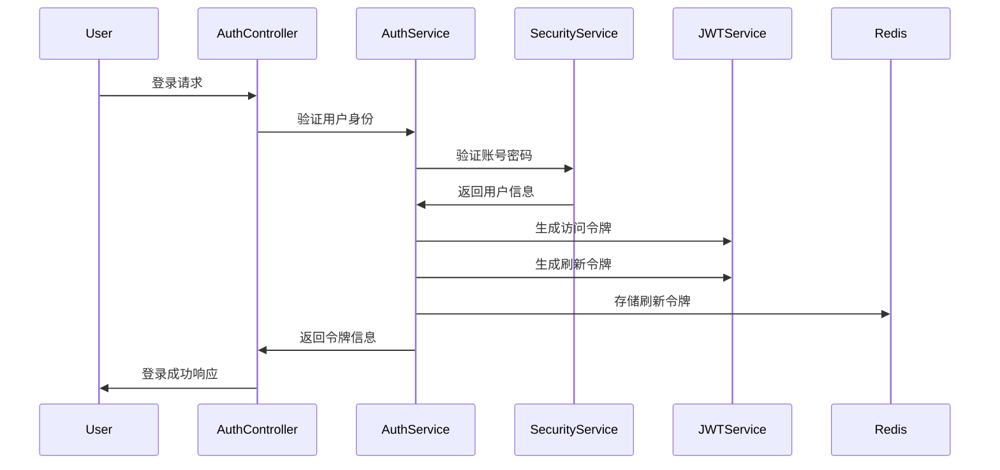

# 认证授权模块设计文档

## 概述

认证授权模块是系统的核心安全组件，负责用户身份验证、权限控制和会话管理。本模块采用JWT（JSON Web Token）实现无状态认证，支持多种登录方式，并提供完整的权限验证机制。

## 架构设计

### 核心组件

```
com.lycorder.auth
├── controller          # 控制器层
│   └── AuthController  # 认证控制器
├── dto                 # 数据传输对象
│   ├── LoginDTO       # 登录请求DTO
│   └── CaptchaVO      # 验证码VO
├── enums              # 枚举类
│   ├── LoginType      # 登录类型
│   └── UserStatus     # 用户状态
└── service            # 服务层
    ├── AuthService    # 认证服务接口
    └── impl
        └── AuthServiceImpl  # 认证服务实现
```

### 认证流程



## 功能详解

### 1. 多方式登录

支持以下登录方式：

#### 1.1 账号密码登录
```java
@PostMapping("/login")
public Result<LoginVO> login(@Valid @RequestBody LoginDTO loginDTO) {
    LoginVO loginVO = authService.login(loginDTO);
    return Result.success(loginVO);
}
```

#### 1.2 手机号登录
```java
@PostMapping("/login/mobile")
public Result<LoginVO> loginByMobile(@Valid @RequestBody MobileLoginDTO dto) {
    LoginVO loginVO = authService.loginByMobile(dto);
    return Result.success(loginVO);
}
```

#### 1.3 邮箱登录
```java
@PostMapping("/login/email")
public Result<LoginVO> loginByEmail(@Valid @RequestBody EmailLoginDTO dto) {
    LoginVO loginVO = authService.loginByEmail(dto);
    return Result.success(loginVO);
}
```

### 2. JWT令牌管理

#### 2.1 令牌结构
访问令牌（Access Token）包含以下信息：
- 用户ID
- 用户名
- 权限列表
- 过期时间（默认2小时）

刷新令牌（Refresh Token）包含：
- 用户ID
- 令牌版本号
- 过期时间（默认7天）

#### 2.2 令牌刷新
```java
@PostMapping("/refresh")
public Result<LoginVO> refresh(@RequestBody RefreshDTO refreshDTO) {
    LoginVO loginVO = authService.refreshToken(refreshDTO.getRefreshToken());
    return Result.success(loginVO);
}
```

### 3. 验证码功能

#### 3.1 图形验证码
```java
@GetMapping("/captcha")
public Result<CaptchaVO> getCaptcha() {
    CaptchaVO captchaVO = captchaService.generateCaptcha();
    return Result.success(captchaVO);
}
```

#### 3.2 短信验证码
```java
@PostMapping("/sms-code")
public Result<Void> sendSmsCode(@Valid @RequestBody SmsCodeDTO dto) {
    smsService.sendCode(dto.getMobile());
    return Result.success();
}
```

### 4. 权限验证

#### 4.1 基于注解的权限控制
```java
@PreAuthorize("hasRole('ADMIN')")
@GetMapping("/admin/users")
public Result<List<UserVO>> getAdminUsers() {
    // 管理员用户列表
}
```

#### 4.2 基于路径的权限控制
```java
@Override
protected void configure(HttpSecurity http) throws Exception {
    http.authorizeRequests()
        .antMatchers("/api/admin/**").hasRole("ADMIN")
        .antMatchers("/api/user/**").hasAnyRole("USER", "ADMIN")
        .anyRequest().authenticated();
}
```

## 安全机制

### 1. 密码安全
- 使用BCrypt算法加密存储
- 强制密码复杂度要求
- 密码错误次数限制
- 定期密码更新提醒

### 2. 令牌安全
- 使用RSA非对称加密签名
- 令牌存储在Redis中可主动失效
- 支持令牌版本控制
- 实现令牌续期机制

### 3. 防护机制
- 登录失败次数限制
- 验证码防暴力破解
- 会话并发控制
- IP白名单支持

## 配置说明

### 1. JWT配置
```yaml
jwt:
  secret: your-secret-key-here
  expiration: 7200  # 2小时
  refresh-expiration: 604800  # 7天
  issuer: real-time-api
  audience: real-time-app
```

### 2. 安全配置
```yaml
security:
  login:
    max-attempts: 5
    lock-duration: 3600  # 锁定1小时
  captcha:
    enabled: true
    length: 4
    expire: 300  # 5分钟
```

## 扩展功能

### 1. 单点登录（SSO）
支持集成第三方认证系统：
- OAuth2.0
- SAML 2.0
- LDAP
- Active Directory

### 2. 多因素认证
- 短信验证码
- 邮箱验证码
- 谷歌验证器
- 生物识别（预留接口）

### 3. 社交登录
- 微信登录
- 支付宝登录
- QQ登录
- 微博登录

## 性能优化

### 1. 缓存策略
- 用户信息缓存（TTL: 30分钟）
- 权限信息缓存（TTL: 1小时）
- 验证码缓存（TTL: 5分钟）

### 2. 数据库优化
- 用户表索引优化
- 登录日志分表存储
- 慢查询监控

### 3. 连接池配置
```yaml
spring:
  datasource:
    druid:
      initial-size: 10
      max-active: 100
      min-idle: 10
      max-wait: 60000
```

## 监控与日志

### 1. 登录日志
记录以下信息：
- 登录时间
- 登录IP
- 登录方式
- 登录结果
- 失败原因

### 2. 安全审计
- 异常登录监控
- 权限变更记录
- 令牌操作日志
- 密码修改记录

## 常见问题

### Q1: 令牌过期如何处理？
A: 使用刷新令牌获取新的访问令牌，刷新令牌过期后需要重新登录。

### Q2: 如何强制用户下线？
A: 在Redis中删除对应的刷新令牌，并将访问令牌加入黑名单。

### Q3: 并发登录如何处理？
A: 通过配置`maximumSessions`控制同一账号的并发会话数。

### Q4: 如何支持移动端登录？
A: 移动端使用相同的认证接口，返回的令牌在请求头中携带。

## 最佳实践

1. **令牌存储**: 前端应将令牌存储在安全的位置（如HttpOnly Cookie）
2. **令牌刷新**: 在令牌过期前主动刷新，避免用户体验中断
3. **错误处理**: 统一的认证失败错误码和信息
4. **密码策略**: 定期更新密码策略，提高安全性
5. **审计日志**: 完整的登录审计日志便于安全分析

## 更新计划

- [ ] 集成OAuth2.0认证
- [ ] 实现多因素认证
- [ ] 支持生物识别认证
- [ ] 添加登录行为分析
- [ ] 实现风险控制系统